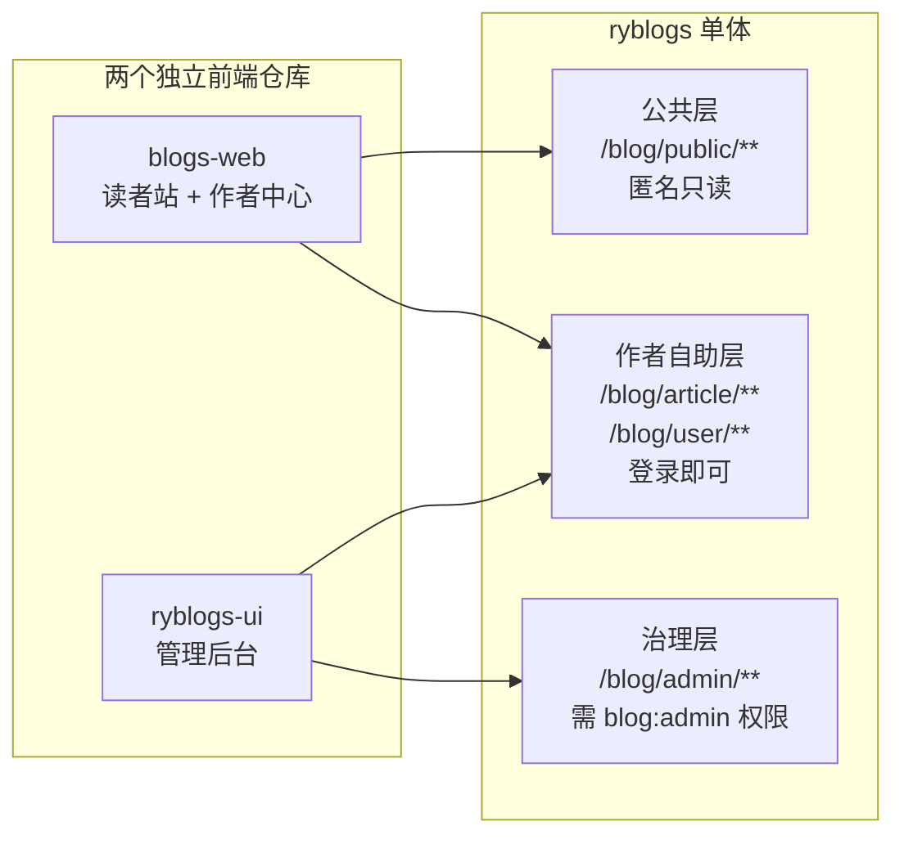
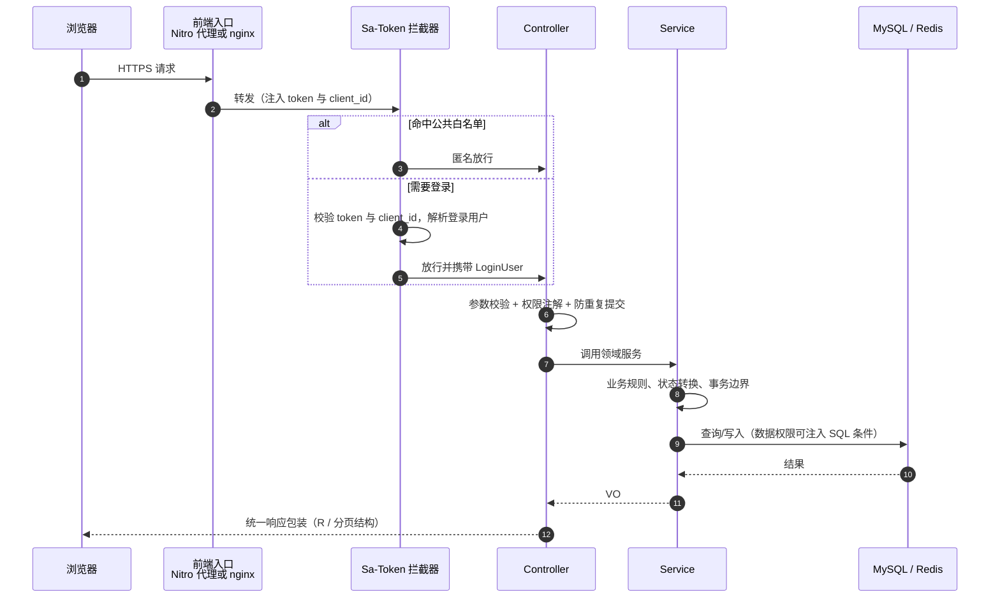
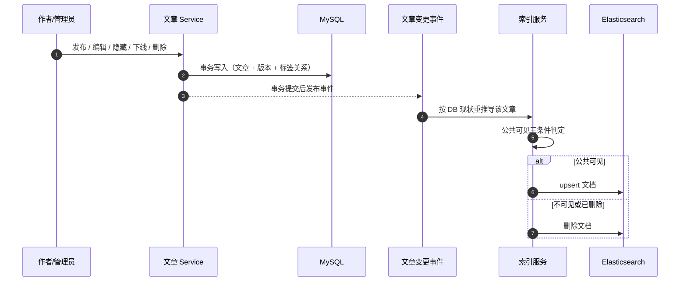
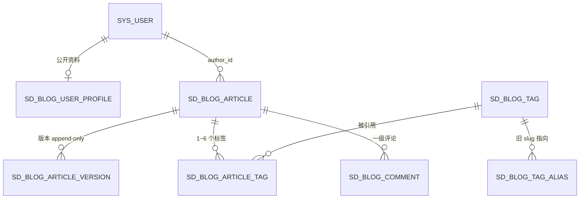
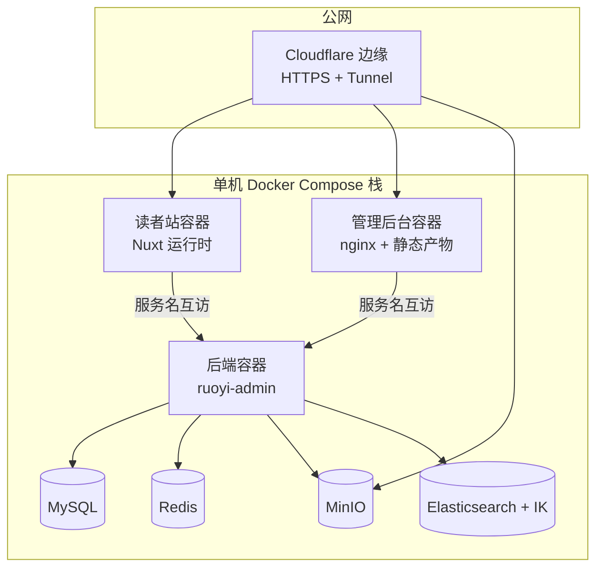

# 系统架构

> 本文只描述「系统长什么样」：仓库边界、后端分层、请求链路、数据模型与部署拓扑。
> 业务规则、接口契约、表结构细节分别以业务仓库内的 `docs/ROADMAP.md`、`docs/blog-api.md`、`docs/database-design-v0.1.md` 为准。

## 1. 三个仓库与三层 API 边界

| 仓库 | 角色 | 调用哪一层 | 鉴权方式 |
|---|---|---|---|
| `blogs-web`（Nuxt 4 SSR） | 读者站 + 作者中心 | `/blog/public/**`（匿名）、`/blog/article/**` 与 `/blog/user/**`（登录） | token 存在 httpOnly cookie，由 Nitro 服务端代理注入，浏览器不持有 token |
| `ryblogs-ui`（Vue 3） | 管理后台：平台治理 + 作者后台 + 系统管理 | `/blog/admin/**`、`/blog/article/**`、`/auth/**`、`/system/**` | token 在请求头，nginx 反代 `/prod-api/` |
| `ryblogs`（Spring Boot 单体） | 唯一后端服务 | — | Sa-Token 校验 token + `client_id`，公共层走白名单放行 |



**为什么要分三层**：读者站的攻击面必须最小——它能调用的接口里不存在任何写他人数据或治理动作；治理能力收在管理后台，权限由后端注解校验，前端隐藏按钮只是一层体验优化。

## 2. 后端模块结构

```text
ruoyi-admin/              唯一启动入口（jar 即容器入口），聚合全部模块
ruoyi-api/                跨模块接口（OSS / 用户等）
ruoyi-common/             横切能力：core / mybatis / redis / security / oss / excel / log / web
ruoyi-modules/
├── sd-blog/              ★ 博客业务（包 org.dromara.blog）
│   ├── controller/       公共层 / 作者自助层 / 治理层 三组控制器
│   ├── domain/           Entity（@TableLogic del_flag）+ bo / vo（mapstruct-plus 编译期转换）
│   ├── mapper/           BaseMapperPlus，复杂 SQL 在 resources/mapper/blog/
│   ├── es/               索引生命周期：mapping / alias / 重建与对账
│   ├── event/            文章变更事件 → 索引增量同步（事务提交后触发）
│   └── service/impl/     业务规则、状态机、事务边界；search/ 下搜索双实现
└── ruoyi-system/ ...     系统管理、代码生成、定时任务等（博客另复用其 OSS 上传能力）
```

博客模块没有自建用户体系：身份、角色、部门、数据权限、对象存储全部沿用框架能力。

## 3. 一次请求的链路



关键约束：

- 归属判断（`author_id`）与操作权限一律在 Service 层按当前登录用户强制校验，**不接受前端传入的 `authorId`**。
- 多表原子操作显式事务：保存文章 + 创建版本 + 回写 `current_version_id` + 同步标签；标签合并 + 关系迁移 + 去重 + alias 落库。
- 统一响应包装与分页结构由框架层提供，Controller 不重复拼装。

## 4. 检索与索引同步



- **索引是投影，不是真相源**：事件失败只记日志，由定时对账（MySQL 公共文章集合 vs ES 文档集合 diff）兜底修正。
- **重建不停服**：新索引 `reindex` 完成后用单请求原子切换 alias，旧索引择机删除；切换期间搜索持续可用。
- **读路径**：ES 只出 id 与打分、高亮；正文永远回表 MySQL，且回表语句内建同一组可见性条件，避免「索引里有、库里没有」的越权读。

## 5. 数据模型要点



| 设计点 | 取舍 |
|---|---|
| 无分类表 | 内容组织只用全局标签；分类体系永久舍弃，避免两套并行的归档模型 |
| 版本 append-only | `article_version` 只 INSERT；内容实际变化才建版本；`current_version_id` 指向生效版本，历史只读 |
| 两个状态位 | `status`（草稿/发布）与 `visibility`（公共/作者隐藏/管理员下线）正交，作者隐藏与管理员下线互不覆盖 |
| 无数据库外键 | 关系由 Service 与事务维护，便于分库与逻辑删除 |
| 逻辑删除 | `del_flag` 为单字符并配逻辑删除注解，不做物理删除 |
| 归属 vs 操作者 | `author_id` 表示归属，`create_by` 表示记录操作者，两者语义不同、不可混用 |

## 6. 部署拓扑



- **七个服务一套编排**：MySQL / Redis / MinIO / ES / 后端 / 读者站 / 管理后台；启动顺序由 healthcheck 强制（依赖健康 → 后端健康 → 前端启动），ES 启动慢且搜索可降级，因此只等「已启动」。
- **只有前端与图片域名对公网暴露**，后端与四个数据服务只绑本机回环地址。
- **发布链**：CI 产出四个不可变镜像（后端、ES、管理后台、读者站）→ 发布工作流预检 → 部署机只拉镜像并执行部署脚本（起栈、切换、回滚、备份、恢复）。部署机不持源码、不编译。
- **回滚口径**：按镜像 digest 回上一组，数据库只前滚（无迁移框架），因此涉及 schema 变更的版本需显式标记。

## 7. 领域红线（实现层面的硬约束）

1. 不建分类表、不引入分类体系，内容组织只用标签。
2. 不新增 `AUTHOR` 角色：所有注册用户天然可发文，治理权限靠 `blog:admin:*` 权限位区分。
3. 公共文章必须同时满足 `status=已发布 AND visibility=公共 AND del_flag=未删除`，公共接口不得绕过；搜索侧同样内建该条件。
4. 版本表只 INSERT，禁止 UPDATE / DELETE；内容未实际变化不产生新版本。
5. 不建数据库外键，关系由 Service 与事务维护；逻辑删除统一走框架风格。
6. 富文本入库前做安全净化（危险标签、事件属性、危险 URL 协议），输出不直接信任用户 HTML。
7. 前端只做体验层的按钮隐藏，权限与归属判断一律以后端为准。
