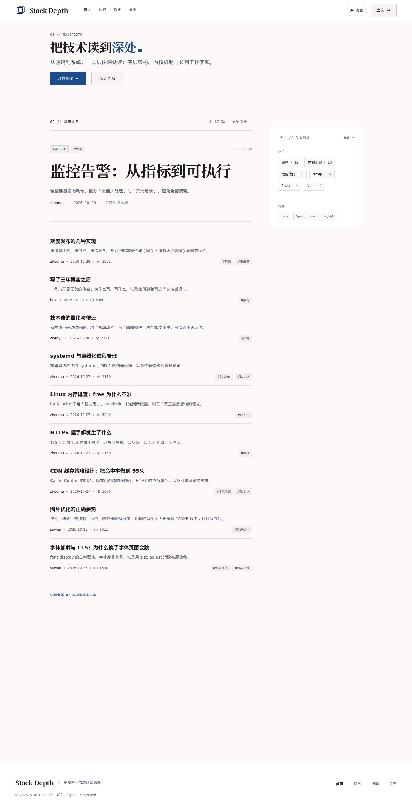
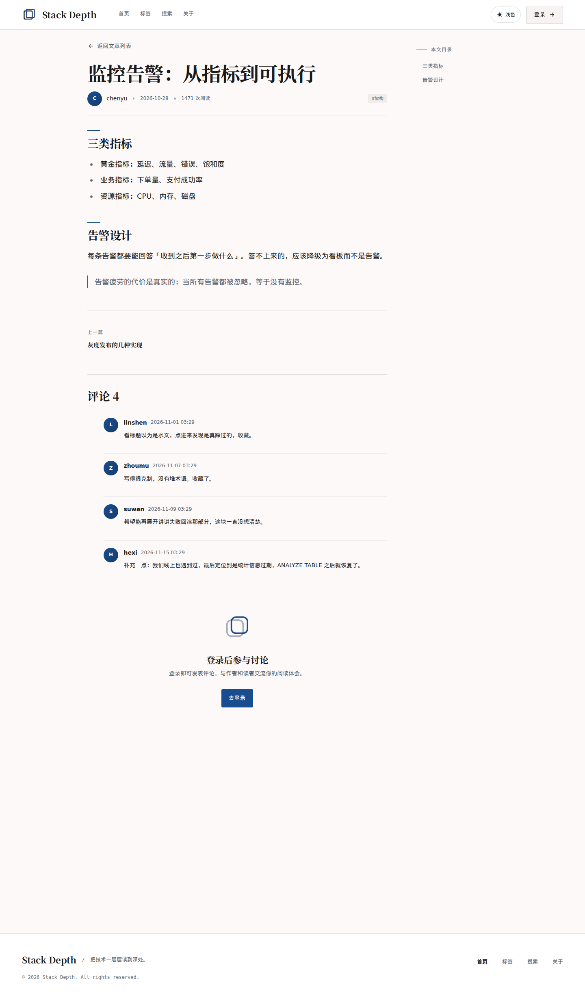
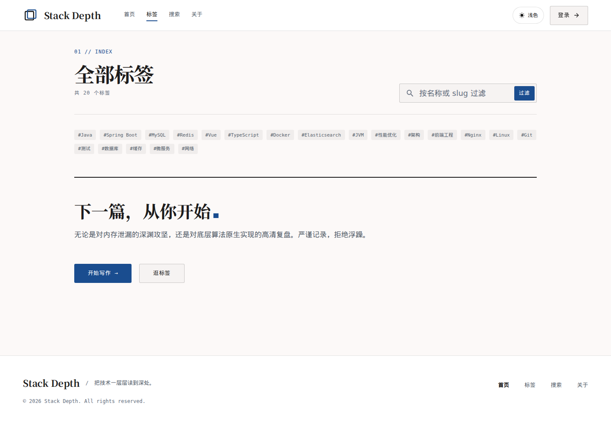
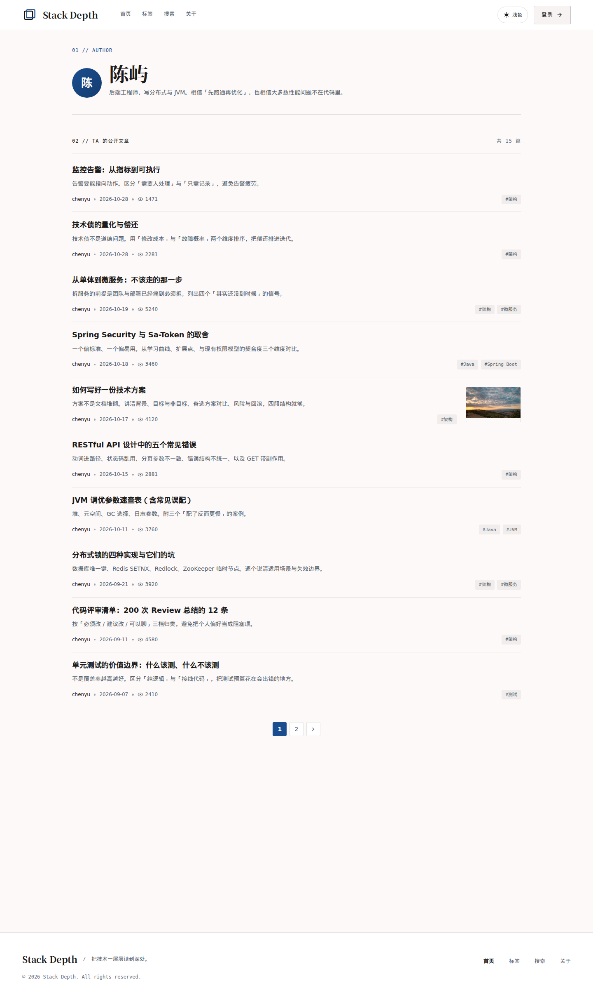
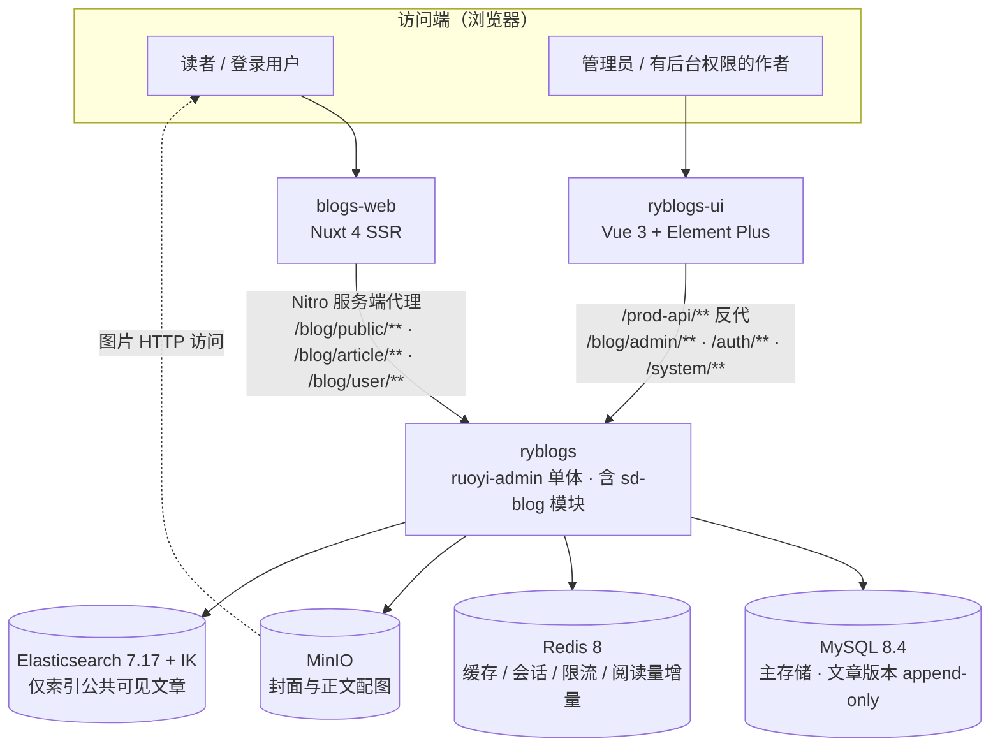

# Stack Depth · 多作者技术博客平台

> 面向技术写作者的多作者博客平台：读者站、登录作者中心、平台治理后台与一个后端服务，共用同一套领域模型与三层 API 权限边界。注册用户即可写作，不区分「作者」角色；平台治理与作者自助是两条独立权限路径。

> 本仓库是**项目总览**，不承载业务代码；实现细节以三个业务仓库为准，本文只做聚合与导航。

## 项目地址与演示体验

- **在线演示（读者站 + 作者中心）：** <https://sdblog.us.ci>
- **管理后台演示：** <https://admin.sdblog.us.ci>
- **后端仓库：** <https://github.com/xcqj/ryblogs>
- **管理端仓库：** <https://github.com/xcqj/ryblogs-ui>
- **读者站仓库：** <https://github.com/xcqj/blogs-web>
- **演示预约与联系：** 招聘平台的对话窗口（不设 Issues 入口）

> **演示环境说明：** 当前演示环境通过 Cloudflare Tunnel 转发至本地 WSL2 上的 Docker Compose 栈，依赖本机与隧道持续运行，因此并非 7×24 小时在线（演示栈按需启停：2026-11-13 复查时两个入口可用，停机期间会返回 502）。若需体验完整系统，请通过招聘平台的对话窗口提前约定时间，我会提前启动演示环境，并在对话中单独提供对应角色的临时体验账号；账号口令不写入本仓库或任何文档。体验账号只用于查看虚构演示数据，管理员同样使用权限受限的临时账号。

本地一键起（不依赖在线演示）。后端 compose 跨仓引用前端产物，**三个仓库必须同级 clone**：

```bash
for r in ryblogs ryblogs-ui blogs-web; do git clone git@github.com:xcqj/$r.git; done
cd ryblogs/script/docker
cp .env.example .env          # 按注释填写本机中间件口令
docker compose up -d --build
# 可选：装载演示种子（5 作者 / 52 篇 / 200 评论 / 20 标签）
SEED_FILE=seed-demo.sql docker compose --profile seed run --rm seed
```

就绪后的本地入口：读者站 `http://localhost:3000` ｜ 管理后台 `http://localhost:8080` ｜ 后端接口与 Swagger `http://localhost:8081`。首次数分钟（构建三个镜像），之后十秒级。

## 项目功能

| 角色 | 主要功能 |
|---|---|
| 读者（匿名与登录） | 文章列表与分页、文章详情（文内 TOC / 代码高亮 / 上下篇）、标签页与标签云、全文搜索、作者公开主页、评论浏览与发表 |
| 作者（所有登录用户） | 作者中心发文、编辑（内容实际变化才生成新版本）、发布、隐藏 / 重新公开、删除自己的文章、封面上传 |
| 管理员与有后台权限的作者 | 他人文章下线与恢复、评论审核与删除、标签重命名与合并（含 alias）、RuoYi 系统管理（用户 / 角色 / 菜单 / 字典） |

范围：单站多作者博客；内容只用全局标签组织，**不设分类体系**；封面与正文配图走对象存储。

明确不做：分类体系（永久舍弃）、版本回滚与版本 diff 界面（数据模型支持、接口未交付）、移动端原生与小程序、多租户。

## 界面预览

以下截图取自真实运行实例（虚构演示数据，浅色主题、桌面视口）。

**读者站 · 首页** —— 最新文章列表、右侧标签云与搜索入口，支持深浅色主题切换。



**读者站 · 文章详情** —— 文内 TOC、代码高亮、上下篇导航与评论区；未登录时引导登录后参与评论。



**读者站 · 全部标签** —— 20 个标签的全局标签页，支持按名称或 slug 过滤。



**读者站 · 作者公开主页** —— 作者资料与公开文章列表、分页。



管理后台（治理文章列表、评论管理、标签治理）与作者中心（我的文章、编辑器）的截图**待补拍**；补拍需先启动演示栈并以临时账号登录。

## 系统架构



- **单体多模块**：唯一部署单元 `ruoyi-admin`，博客业务集中在 `sd-blog` 模块内分层（Controller / Service / Mapper / Domain），模块间走 Service 接口，无 RPC、无消息队列。
- **三层 API 边界互不复用**：`/blog/public/**` 匿名只读 · `/blog/article|user/**` 登录作者自助 · `/blog/admin/**` 平台治理（仅管理后台调用，后端注解校验）。读者站的调用面里不存在治理动作。
- **复用而非重写**：用户、认证、RBAC、数据权限、对象存储、字典、日志、代码生成直接复用 RuoYi-Vue-Plus 既有基础设施。

## 技术栈

| 层次 | 选型 |
|---|---|
| 后端 | Java 21 · Spring Boot（Jetty）· Sa-Token（认证 / 权限）· MyBatis-Plus + mapstruct-plus · SpringDoc |
| 数据与中间件 | MySQL 8.4（主存储）· Redis 8（缓存 / 会话 / 限流 / 阅读量增量，AOF）· MinIO（对象存储，复用 RuoYi OSS）· Elasticsearch 7.17 + IK 中文分词 |
| 管理后台 | Vue 3 · TypeScript · Element Plus · Vite · nginx（静态产物 + `/prod-api` 反代） |
| 读者站 | Nuxt 4 SSR · Vue 3 · TypeScript · UnoCSS（preset-typography）· shiki（保存时预高亮）· WangEditor（按需 CSR 加载） |
| 工程与部署 | Maven 多模块 · Docker Compose（7 服务）· GitHub Actions（三分仓 CI + 四镜像发布链）· Cloudflare Tunnel（演示环境 HTTPS 入口） |
| 测试 | JUnit 5 + Mockito（后端纯逻辑单测）· Vitest（前端单测）· Apifox（接口用例，人工执行） |

## 核心技术实现

**1. 文章版本 append-only + 内容变更判定**
- 问题：直接 UPDATE 正文则历史不可回溯；每次保存都插版本又会产生大量无意义快照，`current_version_id` 语义随之模糊。
- 方案：版本表只允许 INSERT，正文不落主表；主表 `current_version_id` 指向生效版本；保存时比对 title / summary / cover / content 四要素，只有实际变化才建新版本；状态流转不改正文因此不产生版本。判定与时序规则抽成可独立测试的纯逻辑类，Service 只做编排与事务。
- 验证：`VersionPolicy` / `ArticleGuards` 两组纯逻辑用例覆盖版本创建条件、内容比对与状态守卫。
- 边界：没有版本回滚与 diff 界面；`current_version_id` 一致性靠同一事务保证，项目不建外键，无数据库层强约束。

**2. 检索从 MySQL LIKE 切到 Elasticsearch，并保留降级路径**
- 问题：`LIKE '%词%'` 用不上索引，成本随数据量线性增长；中文无空格分词，深翻页语义也容易失真。
- 方案：搜索服务抽成双实现，由 `blog.search.engine=es|mysql` 切换；ES 侧 `multi_match`（IK 分词、标题加权），只取 id 与打分，正文回表 MySQL 后按 ES 序重排并合并服务端 `<em>` 高亮；深翻页用 `after` 游标返回 `nextAfter`；ES 不可用时自动降级 LIKE。
- 验证：20040 篇合成数据、7 组关键词、端到端 `curl -w time_total` 每组 11 次取中位数——LIKE 65~71ms vs ES 5.7~22.6ms（LIKE 命中 0 也是 65ms，即全表扫描）。
- 边界：单机单实例、合成数据、无并发加载，**属单机脚本对比，不是生产压测**；降级是可用性保障，不是性能保障。

**3. 公共可见性内建于索引生命周期，读路径再过滤一次**
- 问题：搜索引擎是第二份数据副本，最容易出的问题是「库里已隐藏、索引里还能搜到」；作者隐藏与管理员下线又是两个独立状态位，漏判即越权。
- 方案：写索引统一按 `status='1' AND visibility='0' AND del_flag='0'` 推导，8 个写方法共用同一事件出口，事件在事务提交后触发；ES 只返回 id，回表 SQL 内建同一组条件，索引残留脏文档也查不出数据；定时对账双向修正；重建走「新索引 → reindex → alias 原子切换」。
- 验证：20040 篇 reindex 用时 2336ms，随后单请求切换 alias，切换期间并发搜索 55/55 全 200；草稿 / 作者隐藏 / 管理员下线 / 逻辑删除四类文章均不出现在搜索结果中（接口用例人工执行）。
- 边界：「切换零中断」只适用于该 alias 场景，不能外推到发布或部署；对账是定时任务，存在最长一个周期的不一致窗口。

**4. 阅读量：Redis 增量 + 访客去重 + 故障降级**
- 问题：详情页每次刷新都 `UPDATE view_count + 1` 会把写压力压到主库，热点文章尤其明显；但阅读量必须可读、不能回退。
- 方案：计数点收敛在详情接口一处；Redis 记增量与访客标识（登录按 userId、匿名按访客指纹），同一访客 30 分钟内只 +1；定时把增量合并回 DB，**DB 是唯一真相源**；Redis 故障时降级直写 DB。
- 验证：人工实测——同访客连续刷新只 +1，换浏览器 +1，flush 后 DB 追平页面显示，停掉 Redis 期间详情持续 200 并走降级写入。
- 边界：**串行人工实测，不是并发一致性验证**；增量不丢依赖 AOF，未在重启场景复测；无热点文章压测。

**5. 权限与内容安全的实现约束**
- 问题：内容平台的风险集中在「谁能改谁的文章」与「用户提交的 HTML 能不能直接信」。
- 方案：作者的增删改查全部按当前登录用户过滤，前端传入的 `authorId` 不参与鉴权；作者隐藏与管理员下线互不覆盖，恢复按来源区分；富文本入库前净化（危险标签、事件属性、危险 URL 协议），正文只存净化后的 HTML 快照；接口按点位限流，限流键生成与判定为纯逻辑；标签重命名产生旧 slug → canonical alias，合并要展平别名链、迁移关系并去重。
- 验证：净化、限流键、限流检查、标签合并在单元测试中覆盖；越权与鉴权失败由接口用例人工验证；限流做了三点位超限人工实测。
- 边界：净化基于标签与属性策略，不做完整 HTML 语义校验；限流是单实例 Redis 计数，不涉及多节点全局配额；无第三方安全评估或渗透测试。

## 测试与验证

以下均为**本机单机环境**的既有记录，本轮未重新执行（演示栈未运行）。

| 验证项 | 方式 | 规模 / 条件 | 结果 | 出处 |
|---|---|---|---|---|
| 后端纯逻辑单测 | JUnit 5 + Mockito，不连数据库、不启 Spring 容器 | 11 个测试类 / 68 个 `@Test` | 覆盖版本策略、状态守卫、净化、限流键与检查、标签合并展平、索引文档构建与对账、阅读量 | 仓库源码统计；以 CI `mvn clean verify` 历史记录为准 |
| 前端单测 | Vitest | 19 个用例（工具函数与组件逻辑） | 同上，以仓库历史记录为准 | 读者站仓库 |
| 接口用例 | Apifox 手工执行 | 五类：正向 / 鉴权失败 / 参数校验 / 资源不存在 / 越权 | 按切片人工执行，**未纳入自动化流水线** | ROADMAP 切片记录 |
| 部署冒烟 | 栈内脚本 + 公网脚本 | 栈内 19 项、公网 8 项（两个入口、反代、sitemap、图片链路） | S29.1 记录全绿；本轮未复跑 | 发布记录（2026-10-30） |
| 检索性能对比 | 端到端 `curl -w time_total` | 20040 篇合成数据、7 组关键词、每组 11 次取中位数 | LIKE 65~71ms vs ES 5.7~22.6ms | S16 benchmark（2026-10-14） |
| 备份 / 恢复 | 备份 → 删库 → 恢复，比对五项行数 | 52 篇 / 52 版本 / 200 评论 / 20 标签 / 8 用户 | 记录一致，搜索与图片恢复可用；本轮未复跑 | 发布记录（2026-10-30） |

口径与限制：`@Test` 数量只是纯逻辑单测规模，不代表集成测试或端到端覆盖；接口用例与冒烟均为人工 / 脚本触发；性能数据保留单机条件与中位数口径，不可当作生产容量结论。**没有做的验证**：并发一致性测试、长时间稳定性与容量测试、渗透测试与第三方安全评估。

## 项目说明与当前边界

- **项目性质**：个人作品与技术演示，业务规则、库表设计与接口契约在业务仓库的文档中（ROADMAP / blog-api / database-design）；演示数据全部虚构（5 作者 / 52 篇 / 200 评论 / 20 标签，其中公共可见 47 篇）。
- **部署形态**：单机 Docker Compose 七服务（MySQL / Redis / MinIO / Elasticsearch / 后端 / 读者站 / 管理后台），启动顺序由 healthcheck 约束；对公网只暴露两个前端入口与图片域名，后端与数据服务不开放公网。发布链 CI 产出四枚不可变镜像，部署机只 `pull` 不编译，回滚按镜像 digest，数据库无迁移框架只前滚。
- **已知边界**：单机部署无高可用与水平扩展；ES 索引不备份（缺失时启动重建）；单元测试之外没有自动化接口回归；移动端原生与小程序未启动；备份与数据同盘，只防误删、不防磁盘损坏。
- **进度**：S0~S28 开发切片已验收，发布链（S29.1）已完成；云服务器上的公网环境（S29.2）阻塞于服务器与备案，尚未启动。
- **凭据**：本仓只含文档与真实运行截图，不含任何账号、口令或环境文件；公开前的审计范围、风险分级与未检查项见 [SECURITY_REVIEW.md](SECURITY_REVIEW.md)。

---

> 本项目基于 [RuoYi-Vue-Plus](https://gitee.com/dromara/RuoYi-Vue-Plus) 二次开发。本仓库仅用于项目展示与导航。
