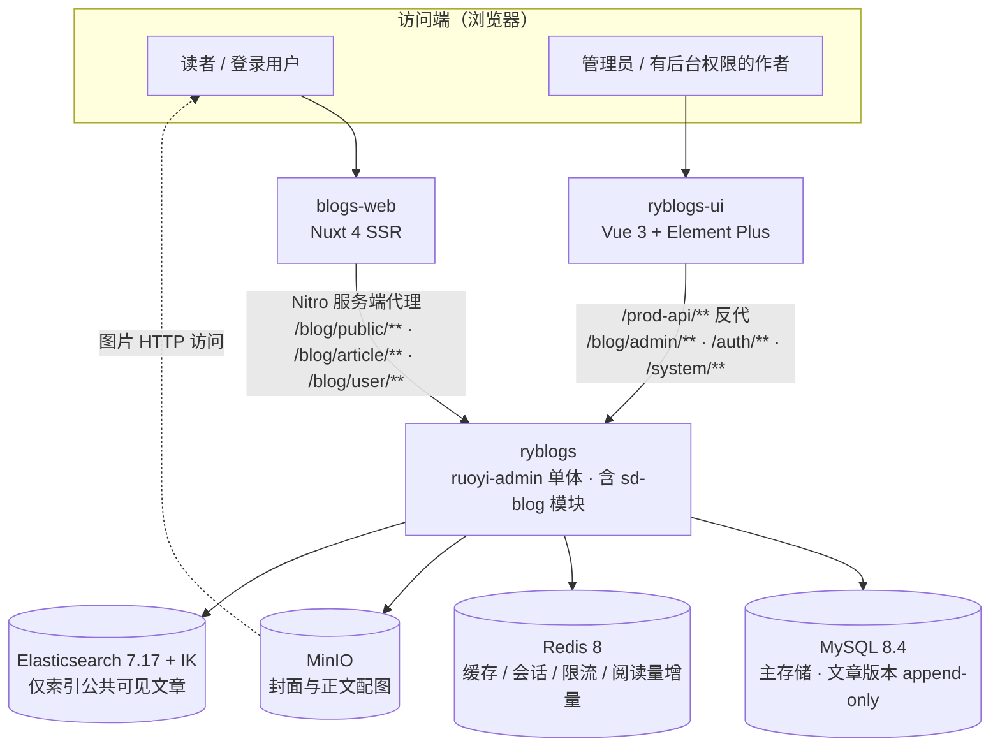
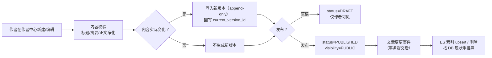
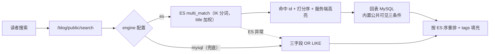

# Stack Depth · 多作者技术博客平台

一套可以完整跑起来的多作者技术博客系统：读者站、登录作者中心、平台治理后台与独立后端服务，共用同一套领域模型与三层权限边界。

> 本仓库是**项目总览**，不承载业务代码。所有实现细节以三个业务仓库为准，本文只做聚合与导航。

**当前状态**：S0~S28 开发切片已逐项验收；发布链（S29.1）已完成；云目标（S29.2）阻塞在服务器与备案；在线演示栈**当前未运行**（见 [在线演示](#在线演示)）。

---

## 1. 项目简介

**Stack Depth** 是一个面向技术写作者的多作者博客平台：注册用户即可写作，不需要单独的「作者角色」；平台侧另外提供管理员治理能力。

| 访问面 | 面向谁 | 核心能力 |
|---|---|---|
| 读者站 | 匿名访客 | 文章列表与分页、文章详情（TOC / 代码高亮 / 上下篇）、标签页与标签云、全文搜索、作者公开主页、评论 |
| 作者中心 | 所有登录用户 | 发文、编辑（内容变化才生成新版本）、发布、隐藏/重新公开、删除自己的文章、历史版本查看、封面上传 |
| 管理后台 | 管理员、有后台权限的作者 | 他人文章下线/恢复、评论审核与删除、标签重命名与合并（含 alias）、RuoYi 系统管理（用户/角色/菜单/字典） |

设计上刻意做了两件事：**不设分类体系**（内容只靠全局标签组织，避免分类与标签二选一的冗余），**不区分普通用户与作者**（归属校验与操作权限全部由后端按当前登录用户强制判定，不信任前端传入的 `authorId`）。

更多背景与决策记录在业务仓库内（私有）：`ryblogs/docs/ROADMAP.md`。

## 2. 在线演示

| 入口 | 地址 | 用途 | 当前状态 |
|---|---|---|---|
| 读者站 + 作者中心 | <https://sdblog.us.ci> | 匿名浏览、登录后发文与自助管理自己的文章 | 当前不可用（演示栈未运行） |
| 管理后台 | <https://admin.sdblog.us.ci> | 平台治理、作者后台、系统管理 | 当前不可用（演示栈未运行） |
| 图片域 | <https://img.sdblog.us.ci> | 封面与正文配图的对象存储对外域名（非独立应用） | 当前不可用（演示栈未运行） |

- 演示环境是**本机单机演示栈**（WSL2 + Docker Compose，公网经 Cloudflare Tunnel 暴露），会随开发机休眠、关机或维护而离线，**不承诺 SLA**。
- 演示数据是虚构种子数据：52 篇文章（其中公共可见 47 篇）、200 条评论、20 个标签、若干虚构作者。
- 演示账号与口令**不在公开文档中出现**，需要体验作者/管理员视角请通过私下渠道索取独立演示账号。匿名浏览读者站无需账号。
- 演示环境的角色、可体验功能与注意事项见 [docs/demo-guide.md](docs/demo-guide.md)。

## 3. 源代码仓库

| 仓库 | 职责 | 主要技术栈 | 可见性 |
|---|---|---|---|
| [`xcqj/ryblogs`](https://github.com/xcqj/ryblogs) | 后端服务：RuoYi-Vue-Plus 6.X 模块化单体，博客业务在独立模块 `sd-blog` | Java 21 · Spring Boot · Sa-Token · MyBatis-Plus · MySQL 8.4 · Redis 8 · MinIO · Elasticsearch 7.17 | Private |
| [`xcqj/ryblogs-ui`](https://github.com/xcqj/ryblogs-ui) | 管理后台（内容治理 + 作者后台 + 系统管理） | Vue 3 · TypeScript · Element Plus · Vite · nginx | Private |
| [`xcqj/blogs-web`](https://github.com/xcqj/blogs-web) | 读者站 + 作者中心（PC 与移动浏览器响应式同一套代码） | Nuxt 4 (SSR) · Vue 3 · TypeScript · UnoCSS · shiki · WangEditor | Private |

> 三个业务仓库**当前均为私有**（Private），未获授权时上述链接不可访问，源码不公开可读。本总览仓只做导航，不复制任何业务代码；需要查看实现细节可单独联系。

## 4. 系统架构

- **单体多模块**：唯一部署单元 `ruoyi-admin`，博客业务在 `sd-blog` 模块内分层（Controller / Service / Mapper / Domain），模块间走 Service 接口，无 RPC。
- **三层 API 边界**：`/blog/public/**`（匿名只读）· `/blog/article|user/**`（登录作者自助）· `/blog/admin/**`（平台治理，仅管理后台调用）。读者站不调用治理接口。
- **复用而非重写**：用户、认证、RBAC、数据权限、对象存储、字典、日志、代码生成等直接复用 RuoYi-Vue-Plus 既有基础设施。

完整链路、数据模型与部署拓扑见 [ARCHITECTURE.md](ARCHITECTURE.md)。

## 5. 核心业务流程

### 5.1 从写作到发布

要点：正文只保存「已净化的 HTML 快照」；版本表只允许 INSERT；可见性判定始终读 DB，搜索引擎只是投影。

### 5.2 公共搜索

公共可见性三条件（`status='1' AND visibility='0' AND del_flag='0'`）同时内建于索引生命周期与回表查询——搜索引擎里不会出现草稿、用户隐藏、管理员下线或已删除的文章。

### 5.3 平台治理

管理员下线（`visibility=ADMIN_HIDDEN`）与作者自我隐藏（`visibility=USER_HIDDEN`）是两个独立状态位，互不覆盖；恢复操作按来源区分。治理动作同样触发索引同步。

## 6. 技术栈

| 层次 | 选型 |
|---|---|
| 后端框架 | Java 21 · Spring Boot（Jetty）· Sa-Token（认证/权限）· MyBatis-Plus + mapstruct-plus · SpringDoc |
| 数据与中间件 | MySQL 8.4（主存储）· Redis 8（缓存/会话/限流/阅读量增量，AOF）· MinIO（对象存储，复用 RuoYi OSS）· Elasticsearch 7.17 + IK 中文分词 |
| 管理后台 | Vue 3 · TypeScript · Element Plus · Vite · nginx（静态产物 + `/prod-api` 反代） |
| 读者站 | Nuxt 4 SSR · Vue 3 · TypeScript · UnoCSS（preset-typography）· shiki（保存时预高亮）· WangEditor（按需 CSR 加载） |
| 工程与部署 | Maven 多模块 · Docker Compose（7 服务）· GitHub Actions（三分仓 CI + 镜像流水线 + 发布链）· Cloudflare Tunnel（演示环境 HTTPS 入口） |
| 测试 | JUnit 5 + Mockito（后端纯逻辑单测）· Vitest（前端单测）· Apifox（接口用例，人工执行） |

## 7. 技术亮点

四条，每条都注明了证据与边界，完整版见 [docs/technical-highlights.md](docs/technical-highlights.md)。

1. **文章版本 append-only + 内容变更判定**：版本表只 INSERT，`current_version_id` 指向生效版本；只有 title/summary/cover/content 真的变化才产生新版本，避免「保存一次多一条历史」。判定与时序规则抽成可独立测试的纯逻辑类。
2. **检索从 MySQL LIKE 切到 Elasticsearch，并保留降级路径**：`ArticleSearchService` 双实现（`engine=es|mysql`）、IK 中文分词、服务端 `<em>` 高亮、深翻页 `after` 游标；ES 异常时自动降级 LIKE。本机 2 万篇合成数据实测（端到端 `time_total` 中位数）：LIKE 65~71ms vs ES 5.7~22.6ms，**属单机脚本对比，不是生产压测**。
3. **公共可见性内建于索引生命周期**：索引只装公共可见文章，回表再按同一组条件过滤；草稿/隐藏/下线/删除四类数据在搜索侧不可达。索引重建走 `reindex + alias 原子切换`，切换期间并发搜索 55/55 全 200（实测记录）。
4. **阅读量异步计数与降级**：详情接口单点计数，Redis 增量 + 同访客 30 分钟去重，DB 为唯一真相源；Redis 故障时降级直写 DB，详情仍 200。**验证为串行人工实测，不是并发一致性验证**。

## 8. 测试与验证

| 类型 | 范围与规模 | 环境 | 结果与限制 |
|---|---|---|---|
| 后端纯逻辑单测 | `sd-blog` 模块 11 个测试类 / 68 个 `@Test` 用例：标签规范化、富文本净化、限流键与检查、版本策略、状态守卫、索引文档构建、索引对账、搜索支持、阅读量、标签合并展平 | 本机 JVM，不连数据库、不启 Spring 容器 | 用例数按仓库源码统计；**本次未重新执行**，以仓库 CI（`mvn clean verify`）历史记录为准 |
| 前端单测 | 读者站 Vitest 19 个用例（工具函数与组件逻辑） | 本机 Node | 同上，以历史记录为准 |
| 接口用例 | Apifox 五类用例（正向 / 鉴权失败 / 参数校验 / 资源不存在 / 越权），按切片人工执行 | 本地运行栈 | 人工执行，未纳入自动化流水线 |
| 部署冒烟 | 栈内 19 项 + 公网 8 项（入口、反代、sitemap、图片链路） | 本机演示栈 | S29.1 记录为全绿；**本次演示栈未运行，未重新执行** |
| 检索性能对比 | 20040 篇合成数据，7 组关键词，端到端 `curl -w time_total`，每组 11 次取中位数并剔除冷启动 | 本机单实例 | 见技术亮点 2 的口径说明，不可当生产压测引用 |
| 备份/恢复演练 | 备份 → 删库 → 恢复，比对五项行数（52 篇 / 52 版本 / 200 评论 / 20 标签 / 8 用户） | 本机演示栈 | S29.1 记录一致；本次未复跑 |

**没有做的验证**：没有并发一致性测试、没有长时间稳定性/容量测试、没有渗透测试与第三方安全评估。上文所有「实测」均为单机、单实例、人工或脚本触发的结果。

## 9. 部署与演示环境

- **形态**：单机 Docker Compose，7 个服务（MySQL / Redis / MinIO / Elasticsearch / 后端 / 读者站 / 管理后台），启动顺序由 healthcheck 约束；对公网只暴露两个前端入口与图片域名，后端与数据服务不开放公网。
- **发布链**：三个仓库各自 CI 门禁 → 打 tag 产出四个不可变镜像 → 发布工作流预检四镜像齐备 → 部署机只 `pull`，不 clone 源码、不编译；回滚按镜像 digest，数据库只前滚（项目无迁移框架）。
- **边界**：这是一套**演示与自用环境**，不是云服务器、不是生产架构、不做高可用；备份与数据同盘，只防误删、不防磁盘损坏。

细节见 [ARCHITECTURE.md](ARCHITECTURE.md) 的部署拓扑与 [docs/demo-guide.md](docs/demo-guide.md) 的体验说明。

## 10. 项目状态与已知限制

**已完成**：账号与资料、文章与版本、编辑器上传、治理状态机、标签治理（重命名/合并/alias）、评论、搜索（ES）、阅读量、接口限流、社交登录、PWA + SEO、全站视觉改版、正文语法高亮、一键启动编排、演示数据种子、全文检索对比与对账、发布链（镜像 + 部署脚本 + 备份恢复）。

**未完成 / 阻塞**：
- 云服务器上的公开生产环境（需服务器与备案，尚未启动）。
- 移动端原生/小程序套件（立项未启动，MVP 后再定）。
- 单元测试之外没有自动化接口回归；Apifox 用例依赖人工执行。

**已知限制**：单机部署无高可用与水平扩展；数据库无迁移框架，回滚只回镜像；搜索引擎索引不备份（缺失时启动重建）；演示数据是虚构内容，不代表真实内容规模。

## 11. 安全审计摘要

公开前对三个业务仓库做了只读审计（2026-11-11）：覆盖当前跟踪文件、Git 历史路径白名单、部署与 CI 配置、种子数据与文档中的默认口令，以及隐私信息（个人绝对路径、内网地址、基础设施标识）。

- **结论**：本总览仓不含任何凭据、口令、内网地址或个人目录信息，**无 Critical / High 阻断项**。
- **限制**：本机未安装专业密钥扫描器（gitleaks / trufflehog 等），审计基于 git 内置能力 + 人工抽查，属**不完整的审计**，不等同于「安全检查通过」。
- 发现的业务仓库内部问题（默认密钥、demo 密钥对复用、默认口令等）只在审计报告中脱敏登记，未修改任何业务仓库。

完整结论、范围与限制见 [SECURITY_REVIEW.md](SECURITY_REVIEW.md)。

## 12. 文档索引

| 文档 | 内容 |
|---|---|
| [ARCHITECTURE.md](ARCHITECTURE.md) | 三仓职责边界、后端模块结构、请求链路、检索与索引同步、数据模型、部署拓扑、领域红线 |
| [docs/demo-guide.md](docs/demo-guide.md) | 演示入口、可体验角色与路径、体验注意事项、可用性边界 |
| [docs/technical-highlights.md](docs/technical-highlights.md) | 关键技术方案：问题 → 方案与取舍 → 验证 → 边界 |
| [SECURITY_REVIEW.md](SECURITY_REVIEW.md) | 公开前安全审计范围、结果分级、建议与未检查项 |

---

> 本项目基于 [RuoYi-Vue-Plus](https://gitee.com/dromara/RuoYi-Vue-Plus) 二次开发。本仓库仅用于项目展示与导航。
